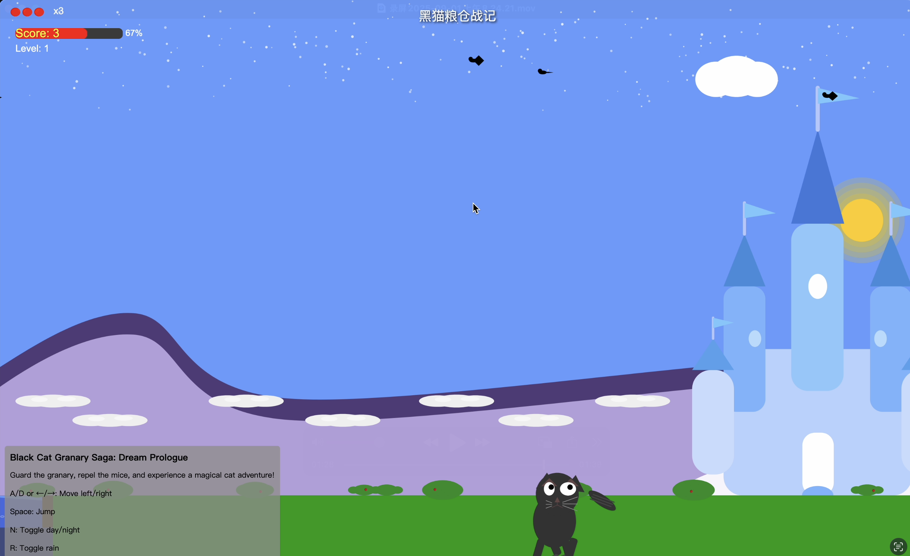
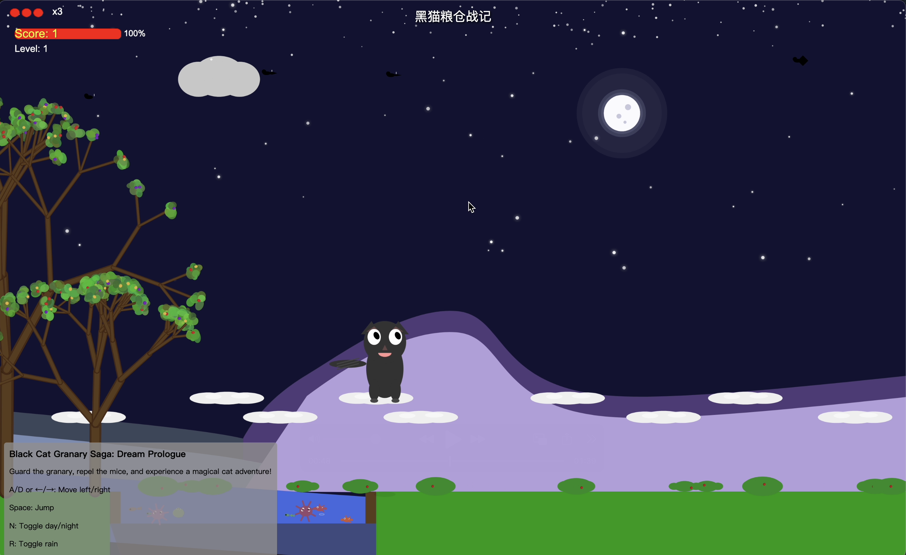
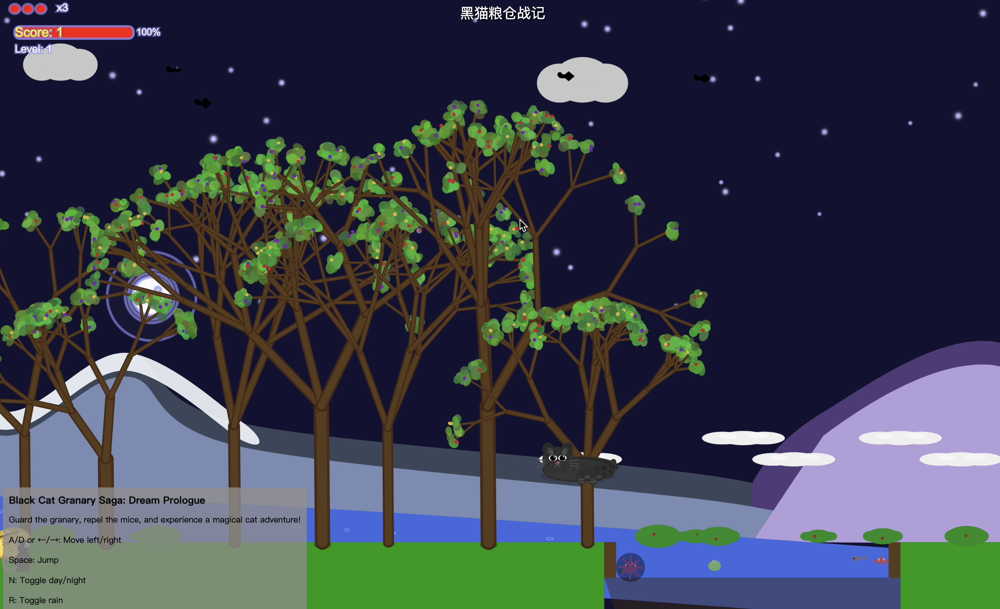
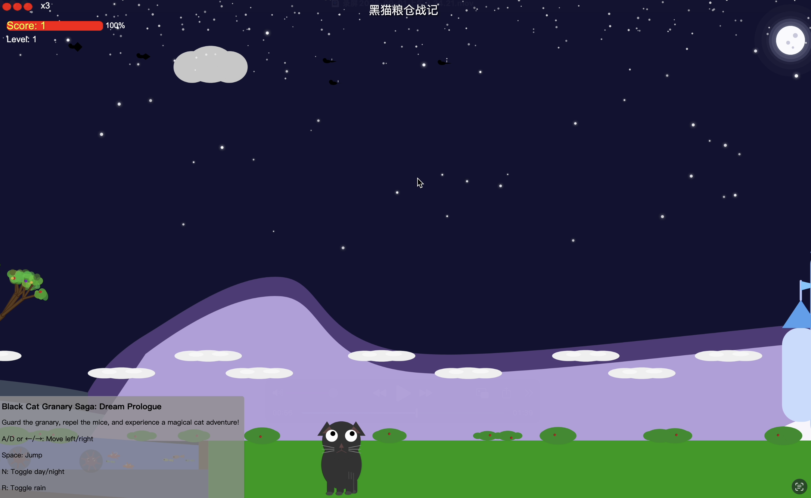

[English](README.md) | **简体中文**

# 黑猫粮仓传奇：梦之序章 🐱⚔️

> **伦敦大学计算机科学本科期末编程作业 1**  
> 一款使用 p5.js 开发的 2D 平台跳跃游戏，讲述黑猫勇士守护粮仓的冒险故事

[](https://Leechuihui.github.io/Programing-1--final-exam-report-game_project_6)
[](https://p5js.org/)
[](https://developer.mozilla.org/en-US/docs/Web/JavaScript)
[](https://developer.mozilla.org/en-US/docs/Web/HTML)
[](https://developer.mozilla.org/en-US/docs/Web/CSS)

## 🎬 观看演示视频

<div align="center">

### 📹 游戏演示视频

<div align="center">

[](https://Leechuihui.github.io/Programing-1--final-exam-report-game_project_6/video.html)

**📥 [下载游戏演示（19.9 MB）](https://github.com/Leechuihui/Programing-1--final-exam-report-game_project_6/blob/main/assets/videos/demo1.mov)**

*完整游戏流程演示，展示全部功能*


---

## 🎮 游戏预览

### 📸 截图

<div align="center">

#### 🌅 白天模式 — 村庄粮仓

*影爪在白昼中守护粮仓*

#### 🌙 夜晚模式 — 星空

*繁星闪烁与流星特效交织的梦幻夜景*

#### ⚡ 天气特效 — 风暴

*包含雨、雪与闪电的动态天气系统*

#### 🐭 战斗系统

*与智能 AI 老鼠敌人展开的策略战斗*

#### 🎁 道具与收集品

*加速、护盾、磁铁与生命道具*

</div>

### 🖼️ 截图画廊

<div align="center">

| 🌅 白天模式 | 🌙 夜晚模式 |
|-------------|---------------|
|  |  |

| ⚡ 天气特效 | 🐭 战斗系统 |
|-------------------|------------------|
|  |  |

</div>

### 🎯 在线演示与视频

<div align="center">

[](https://Leechuihui.github.io/Programing-1--final-exam-report-game_project_6) [](https://github.com/Leechuihui/Programing-1--final-exam-report-game_project_6/blob/main/assets/videos/demo1.mov)

**🎮 直接在浏览器中游玩 | 📹 观看演示视频（19.9 MB）**

</div>

---

## 📖 项目概述

**黑猫粮仓传奇：梦之序章** 是一款饱含深情的 2D 平台跳跃游戏，既是一场趣味冒险，也是对童年记忆的深情致敬。玩家将操控影爪（Shadowpaw）——一只勇敢的黑猫勇士，在 1970 年的秋天守护村庄的粮仓。

这款游戏不仅仅是娱乐——它更是一座数字化纪念丰碑，献给一只深爱的山猫伙伴。它曾在童年六年宝贵的时光里带来温暖、快乐与无条件的爱。游戏中的每一个细节，从轻柔的呼噜声到主角守护者的身份，都体现了孩子与其最珍视的猫咪朋友之间深厚的羁绊。

游戏将动作、冒险与收集元素融为一体，配合炫目的视觉效果与丰富的玩法机制，带来身临其境的游戏体验，致敬那位永远不会被遗忘的特殊伙伴。

### 🎯 游戏故事背景

#### 💝 献给童年记忆的深情致敬

这款游戏的灵感源自一段珍藏的童年记忆。小时候，我拥有一只最美丽的山猫，它成了我最亲爱的伙伴，陪伴我度过六年美好的时光。在那段珍贵的童年岁月里，这只出色的猫咪一直陪伴着我——在寒冷的冬夜给我温暖，与我相拥取暖，陪我玩耍，并以只有真正朋友才能做到的方式照顾着我。

那六年充满了无条件的爱、伴我入眠的轻柔呼噜声，以及无数纯粹的快乐时光。即使现在，我依然深深怀念那只山猫，而这款游戏正是我让那些美好回忆延续下去的方式。游戏中的每一次跳跃、每一段冒险，都是对那只特别的猫在我最脆弱的岁月里给予我的温暖与守护的致敬。

#### 🐱 游戏的故事

1970 年晚秋，下午 5 点 24 分。村庄粮仓外，黑猫影爪凝望着远方。鼠王及其大军一直在偷窃粮食，村民们忍饥挨饿。村长将最后一块玉米饼交给影爪，希望它能守住粮仓，重燃希望。

夜幕降临，风中传来鼠群的呢喃。影爪裹紧披风，踏上了它的守护之旅……

游戏主角影爪正是那只深爱的山猫精神的化身——勇敢、守护、满怀爱意。当玩家引导影爪完成粮仓保卫战时，他们不只是在玩一款游戏，更是在经历一段关于爱、记忆以及孩子与最珍视的伙伴之间牢不可破羁绊的旅程。

## ✨ 核心特性

### 🎮 游戏机制
- **平台跳跃系统**：流畅的 2D 物理引擎，跳跃控制精准
- **战斗系统**：与智能 AI 老鼠敌人展开策略战斗
- **收集系统**：收集鱼、苹果、米等物品恢复生命值
- **道具系统**：获得加速、跳高、护盾、磁铁等特殊能力
- **连击系统**：连续动作可获得分数倍率加成

### 🌤️ 动态天气系统
- **昼夜循环**：白天与夜晚的视觉变化
- **雨雪特效**：逼真的降水粒子系统
- **闪电特效**：风暴中戏剧化的闪电动画
- **地面积雪**：地面上的物理积雪堆积
- **天气计时器**：天气状态自动切换

### 🎨 视觉特效
- **粒子系统**：丰富的视觉效果与动画
- **星空背景**：动态星场与流星特效
- **云朵平台**：可跳跃的移动云平台
- **多样地形**：山丘、岩石、花朵、洞穴等环境元素
- **荷叶系统**：水面上漂浮的动态荷叶

### 🎵 音频系统
- **背景音乐**：沉浸式游戏背景音乐
- **音效**：跳跃、收集与战斗的音频反馈
- **天气音效**：雨声、风声等环境音
- **动态音频**：根据游戏状态调整音效

### 📊 进度系统
- **计分系统**：多层次的计分机制
- **成就系统**：15 项可解锁的不同成就
- **等级系统**：经验值与等级提升
- **统计系统**：详细的游戏数据追踪

## 🛠️ 技术栈

### 前端技术
- **p5.js 1.9.0** - 2D 图形渲染与游戏引擎
- **p5.sound** - 音频处理与音效
- **HTML5 Canvas** - 游戏画布渲染
- **CSS3** - UI 样式与动画
- **JavaScript ES6+** - 游戏逻辑与交互

### 架构设计
- **模块化设计**：清晰的代码组织结构
- **面向对象编程**：使用 ES6 类进行代码封装
- **事件驱动**：灵敏的用户交互系统
- **状态管理**：完善的游戏状态控制

## 🚀 快速开始

### 运行要求
- 现代浏览器（Chrome、Firefox、Safari、Edge）
- 支持 HTML5 Canvas 与 Web Audio API
- 推荐屏幕分辨率：1920x1080 或更高

### 安装与运行

1. **克隆项目**
   ```bash
   git clone https://github.com/Leechuihui/Programing-1--final-exam-report-game_project_6.git
   cd Programing-1--final-exam-report-game_project_6
   ```

2. **启动本地服务器**
   ```bash
   # 使用 Python 启动本地服务器
   python -m http.server 8000
   
   # 或使用 Node.js
   npx http-server
   
   # 或使用 Live Server 扩展（推荐）
   ```

3. **访问游戏**
   ```
   http://localhost:8000
   ```

### 在线体验
- [GitHub Pages 在线版本](https://Leechuihui.github.io/Programing-1--final-exam-report-game_project_6)

## 🎮 游戏操作

### 基本操作
| 按键 | 功能 |
|-----|----------|
| `WASD` / `方向键` | 移动小猫 |
| `空格键` | 跳跃 |
| `鼠标左键` | 跳跃 |
| `鼠标右键` | 发射鱼骨 |

### 特殊功能
| 按键 | 功能 |
|-----|----------|
| `P` | 暂停/继续游戏 |
| `R` | 重新开始游戏 |
| `M` | 开关声音 |
| `N` | 切换昼夜模式 |
| `G` | 切换下雪特效 |
| `T` | 自动测试跳跃 |
| `X` | 重置小猫位置 |

## 📁 项目结构

```
game_project_6/
├── index.html              # 主页面文件
├── sketch.js               # p5.js 主程序入口
├── main.js                 # 游戏主逻辑控制器
├── character.js            # 角色系统模块
├── environment.js          # 环境系统模块
├── weather.js              # 天气系统模块
├── score_system.js         # 计分系统模块
├── audio_system.js         # 音频系统模块
├── game_modules.js         # 游戏模块合集
├── p5.min.js               # p5.js 库文件
├── p5.sound.min.js         # p5.sound 库文件
├── assets/                 # 资源目录
│   ├── audio/              # 音频文件
│   │   └── background.mp3  # 背景音乐
│   └── images/             # 图片资源
│       ├── story1.jpg      # 故事插图 1
│       ├── story2.jpg      # 故事插图 2
│       └── story3.jpg      # 故事插图 3
├── asset/                  # 附加资源
│   ├── frog.mp3           # 青蛙音效
│   └── rain.mp3           # 雨声音效
├── story.md               # 故事背景文档
├── README.md              # 项目文档
└── docs/                  # 技术文档
    ├── development_log.md # 开发日志
    ├── technical_docs.md  # 技术文档
    └── architecture.md    # 架构设计
```

## 🎯 游戏目标

### 主要目标
- **收集鱼**：获得 25 分并恢复 15 点生命值
- **击败老鼠**：获得 10 分并提升连击
- **收集物品**：苹果（5 分）、米（15 分）等额外奖励
- **达到 1000 分**：完成关卡挑战

### 成就系统
- 🏆 **初次击杀** - 击败你的第一只老鼠
- 🎯 **捕鼠达人** - 击败 10 只老鼠
- 🐟 **爱吃鱼** - 收集 10 条鱼
- ⚡ **连击大师** - 达成 20 连击
- 🛡️ **完美之猫** - 完成 10 次完美落地
- 🌟 **生存专家** - 存活 5 分钟

## 🔧 开发历程

### 第一阶段：项目规划（第 1-2 周）
- 确定游戏概念与核心机制
- 设计游戏架构与模块划分
- 搭建基础项目结构

### 第二阶段：核心开发（第 3-6 周）
- 实现角色系统与物理引擎
- 开发环境系统与视觉特效
- 集成音频系统与音效

### 第三阶段：功能增强（第 7-8 周）
- 实现天气系统与粒子特效
- 开发计分系统与成就系统
- 优化游戏性能与用户体验

### 第四阶段：测试与优化（第 9-10 周）
- 全面的游戏功能测试
- 修复 Bug 并提升性能
- 完善文档并完成部署

## 🐛 已知问题

### 当前问题
1. **云平台碰撞检测**：某些情况下可能出现位置偏移
2. **天气切换时机**：雪落地面检测可能需要优化
3. **音频加载**：部分浏览器可能出现音频加载延迟
4. **移动端适配**：触屏控制仍需进一步优化

### 优化建议
- 改进碰撞检测算法以提高精度
- 优化粒子系统性能
- 提升移动端用户体验
- 增加更多游戏关卡与内容

## 🤝 参与贡献

欢迎提交 Issue 和 Pull Request 来改进本项目！

### 如何贡献
1. Fork 本项目
2. 创建你的功能分支（`git checkout -b feature/AmazingFeature`）
3. 提交更改（`git commit -m 'Add some AmazingFeature'`）
4. 推送到分支（`git push origin feature/AmazingFeature`）
5. 发起 Pull Request

## 📄 许可证

本项目基于 MIT 许可证发布 - 详情请参阅 [LICENSE](LICENSE) 文件

## 👨‍💻 作者

**伦敦大学计算机科学本科生**
- 项目：黑猫粮仓传奇：梦之序章
- 课程：Programming 1 期末考试
- 学期：2025 年春季

## 🙏 致谢

- 感谢 p5.js 社区提供的出色框架
- 感谢伦敦大学计算机科学系的指导
- 感谢所有测试用户提供的宝贵反馈

## 📞 联系方式

如有问题或建议，请通过以下方式联系：
- 在 [GitHub Issue](https://github.com/Leechuihui/Programing-1--final-exam-report-game_project_6/issues) 中提问
- 发送邮件至：lizhuhui999@gmail.com

---

---

## 💝 结语

<div align="center">

### 🌟 向社区发出的诚挚邀请

**这个项目并不完美——但这没关系！**

*每款游戏都有 Bug，每个代码库都有改进空间，每位开发者都会在每个项目中学到新东西。*

</div>

### 🎯 我们的愿景

我们相信**开源协作**能将这份个人致敬之作变成真正非凡的东西。这款游戏最初是为了纪念一位深爱的童年伙伴而诞生，但它有潜力走得更远。

### 🤝 加入我们的旅程

**我们邀请你：**
- **报告 Bug** —— 你在游玩过程中发现的问题
- **提出改进建议** —— 让游戏变得更好
- **贡献代码** —— 修复问题或添加功能
- **分享你自己的故事** —— 关于深爱的童年伙伴
- **帮助我们让这款游戏臻于完美** —— 造福所有人

### 🐛 为什么需要你的帮助

这款游戏存在若干已知问题：
- 需要**性能优化**以获得更流畅的游戏体验
- 需要改进**跨浏览器兼容性**
- 需要增强**移动端体验**以改善触屏控制
- 需要修复**音频同步**问题以提升沉浸感
- 还有**更多功能**可以让游戏更具吸引力

### 🙏 谢谢你

<div align="center">

**每一份 Bug 报告、每一条建议、每一次贡献都很重要。**

*让我们一起创造美好的事物——它致敬的不仅是一位童年的伙伴，还有所有深爱的宠物为我们的生活带来的爱与欢乐。*

**让我们一起让这款游戏臻于完美！** 🐱💖

</div>

---

**🎮 现在就开启你的黑猫冒险之旅吧！**

*“守护粮仓，击退鼠群，体验一场奇妙的猫咪冒险！”*

**🌟 特别感谢开源社区帮助我们把这个项目做得更好！**
